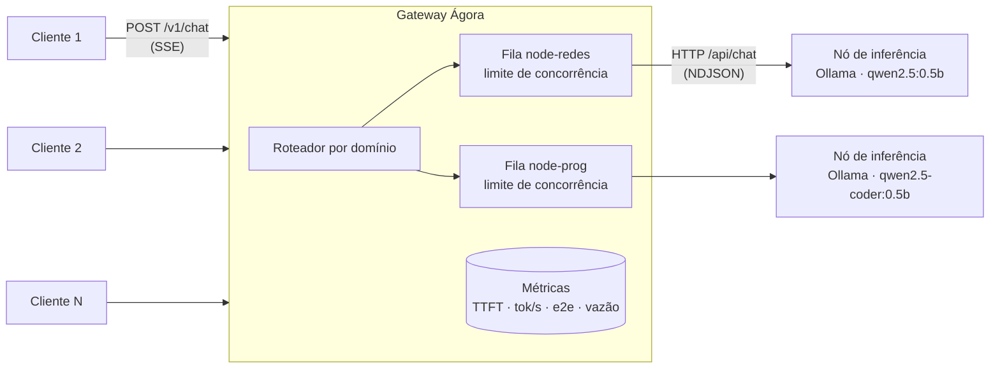

# Ágora — um gateway distribuído para orquestrar LLMs abertos

Trabalho da disciplina **Redes de Computadores** (UFES · Prof. Magnos Martinello) — **Projeto 1: Gateway distribuído de LLMs abertos**.

**Dupla:** Matheus Santos de Moura · Yan Maia

---

## A ideia

Na Grécia antiga, a *ágora* era a praça onde as pessoas se reuniam para perguntar, debater e ser ouvidas. O **Ágora** faz esse papel para modelos de linguagem: é um **gateway** que recebe perguntas de vários clientes ao mesmo tempo e as encaminha, **em streaming token a token**, para o **nó de inferência certo** de cada domínio (por exemplo, "assistente de Redes" ou "assistente de programação").

Os modelos são de **pesos abertos** e rodam **localmente** (Ollama, só CPU), ou seja, dados e modelos ficam sob nosso controle, em linha com a ideia de soberania digital. O objetivo do projeto é mostrar, com medições, que um serviço de IA é, antes de tudo, um **problema de Redes**: filas, concorrência, roteamento, transporte em streaming (SSE sobre HTTP), balanceamento de carga e failover.

### Arquitetura



1. O cliente envia `POST /v1/chat` com o **domínio** declarado e a pergunta.
2. O gateway escolhe o nó do domínio e reserva um lugar na **fila daquele nó**. Se a fila estiver cheia, responde `503` + `Retry-After` antes de abrir o stream.
3. Quando há vaga (limite de concorrência do nó), o gateway monta a requisição com o **prompt de sistema e os parâmetros do domínio** e chama o Ollama em streaming.
4. Cada pedaço recebido do nó vira um evento **SSE** `token` para o cliente, na hora, sem acumular.
5. No fim, o evento `done` traz as métricas da requisição, que também são gravadas em `logs/requests.jsonl`.

### Domínios (M1)

| Domínio | Nó | Modelo | Prompt de sistema / parâmetros |
| --- | --- | --- | --- |
| `redes` | `node-redes` | `qwen2.5:0.5b` | Monitor da disciplina de Redes · `temperature 0.3`, `num_predict 256` |
| `programacao` | `node-prog` | `qwen2.5-coder:0.5b` | Assistente de programação em Python · `temperature 0.2`, `num_predict 384` |

Os dois modelos têm ~400 MB cada e rodam bem só em CPU. Tudo é configurável em [`config/gateway.yaml`](config/gateway.yaml) e no `.env`.

### Protocolo cliente ↔ gateway

`POST /v1/chat` com corpo JSON:

```json
{ "domain": "redes", "prompt": "O que é o three-way handshake?", "max_tokens": 128 }
```

(ou `"messages": [{"role": "user", "content": "..."}, ...]` para enviar um histórico)

A resposta é `text/event-stream`, com quatro tipos de evento:

```text
event: meta     data: {"request_id": "...", "domain": "redes", "node": "node-redes", "model": "...", "queue_position": 0}
event: token    data: {"text": "O "}            ← um por token, na ordem
event: done     data: {"ttft_ms": 812.4, "e2e_ms": 5230.1, "output_tokens": 98, "gateway_tps": 22.3, ...}
event: error    data: {"message": "..."}         ← se o nó falhar no meio
```

Outros endpoints: `GET /health` (nós no ar? modelos baixados?), `GET /v1/domains`, `GET /v1/nodes` (ocupação das filas), `GET /metrics` (resumo agregado) e `GET /metrics/requests` (últimas requisições).

### Métricas instrumentadas

Medidas no gateway, a partir da chegada da requisição:

| Métrica | Definição |
| --- | --- |
| **TTFT** (`ttft_ms`) | chegada → primeiro token enviado ao cliente (inclui fila + prefill) |
| **Espera na fila** (`queue_wait_ms`) | chegada → nó libera vaga |
| **Tokens/s** (`gateway_tps`) | tokens gerados ÷ (e2e − TTFT): o ritmo que o usuário vê |
| **Tokens/s do nó** (`node_tps`) | `eval_count / eval_duration` informado pelo Ollama |
| **Latência fim a fim** (`e2e_ms`) | chegada → último token |
| **Vazão** | tokens/s agregados de todas as requisições numa janela (`/metrics`) |

O cliente de carga (`client/bench.py`) mede as mesmas grandezas **do lado do cliente**, o que inclui a rede até o gateway.

---

## Como rodar

### Opção A — Docker Compose (recomendada)

Pré-requisito: Docker Desktop (Windows/macOS) ou Docker Engine (Linux).

```bash
cp .env.example .env          # ajuste memória/CPU se precisar
docker compose up -d --build  # sobe 2 nós Ollama, baixa os modelos e sobe o gateway
docker compose logs -f gateway
curl http://localhost:8000/health
```

Com tudo no ar, abra **http://localhost:8000** no navegador: é a interface web de chat (escolha do assistente, respostas token a token, botão de parar, histórico por assistente e as métricas TTFT/tokens/s de cada resposta). O arquivo fica em `gateway/agora/static/index.html`; depois de editá-lo, rode `docker compose up -d --build gateway`.

**Orçamento de memória (somente CPU):** cada nó tem limite de 3 GB e o gateway de 512 MB, ≈ **6,5 GB no total**, abaixo dos 8 GB que definimos como teto para rodar também na máquina com menos RAM. No Windows, o Docker Desktop usa o WSL2: para limitar a VM inteira, crie `%UserProfile%\.wslconfig` com:

```ini
[wsl2]
memory=8GB
processors=4
```

e rode `wsl --shutdown` antes de abrir o Docker de novo.

### Opção B — sem Docker (Ollama instalado na máquina)

```bash
ollama pull qwen2.5:0.5b
ollama pull qwen2.5-coder:0.5b

python -m venv .venv
.venv\Scripts\activate           # Windows  (Linux/macOS: source .venv/bin/activate)
pip install -r requirements-dev.txt

# Windows PowerShell: $env:GATEWAY_CONFIG="config/gateway.local.yaml"
export GATEWAY_CONFIG=config/gateway.local.yaml
uvicorn agora.main:create_app --factory --app-dir gateway --port 8000
```

### Opção C — nó falso (sem LLM, para testar protocolo e filas)

`agora.fake_node` imita a API do Ollama com tempo de serviço determinístico. É útil para testar sem gastar CPU e para validar o modelo de fila do experimento.

```bash
# terminal 1 (dentro de gateway/)
python -m agora.fake_node --port 11435 --parallel 2

# terminal 2 (na raiz do repositório)
export GATEWAY_CONFIG=config/gateway.fake.yaml   # PowerShell: $env:GATEWAY_CONFIG="config/gateway.fake.yaml"
uvicorn agora.main:create_app --factory --app-dir gateway --port 8000
```

### Usando

```bash
# pergunta avulsa (o texto aparece token a token)
python client/chat.py -d redes "Explique o controle de congestionamento do TCP"

# modo conversa, com histórico
python client/chat.py -d programacao

# carga: 1, 2, 4 e 8 clientes simultâneos, 2 perguntas cada, 3 repetições
python client/bench.py -c 1 2 4 8 -r 2 --repeat 3 -d redes -n 64

# testes automáticos
pytest
```

### Problemas comuns (Windows)

| Sintoma | Causa | Solução |
| --- | --- | --- |
| `failed to connect to the docker API at npipe:////./pipe/docker_engine` | O Docker Desktop não está aberto | Abra o Docker Desktop e espere aparecer **"Engine running"**; confira com `docker info` |
| `ModuleNotFoundError: No module named 'httpx'` | Terminal sem o venv ativado | `.venv\Scripts\activate` em **cada** terminal novo (o prompt passa a mostrar `(.venv)`) |
| `.venv\Scripts\activate`: "O sistema não pode encontrar o caminho" | O venv ainda não foi criado nessa pasta | `python -m venv .venv` e depois `pip install -r requirements-dev.txt` |
| PowerShell bloqueia o `Activate.ps1` | Política de execução de scripts | `Set-ExecutionPolicy -Scope CurrentUser RemoteSigned` (uma vez) |
| Porta 8000 ocupada ou respostas "estranhas" | Gateway do Docker **e** `uvicorn` local ao mesmo tempo | Use um só: `docker compose ps` mostra se o do Docker está de pé; ou rode o local com `--port 8001` e `chat.py -u http://localhost:8001` |
| Mudou código do gateway e nada mudou no Docker | A imagem foi construída com o código antigo | `docker compose up -d --build gateway` (só mudar o YAML pede apenas `docker compose restart gateway`) |

### Estrutura do repositório

```text
gateway/agora/
  main.py         API HTTP, roteamento por domínio e streaming SSE
  node_queue.py   fila por nó com limite de concorrência (política plugável)
  ollama.py       cliente da API de streaming do Ollama
  metrics.py      TTFT, tokens/s, e2e, vazão e log JSONL
  config.py       leitura do YAML (com variáveis de ambiente)
  fake_node.py    nó falso compatível com o Ollama
  static/index.html  interface web de chat (servida em GET /)
client/
  chat.py         cliente de linha de comando
  bench.py        gerador de carga (base do experimento) → CSV em results/
config/           gateway.yaml (Docker) · gateway.local.yaml · gateway.fake.yaml
tests/            testes da fila e do gateway (pytest)
docker-compose.yml
```

---

## Checkpoints

Legenda: ✅ feito · 🔄 em andamento · ⬜ a fazer

### M1 — Núcleo funcionando (fim do 1º terço) · demonstração de 5 min

- ✅ **1.1 Esqueleto do repositório**: estrutura, configuração em YAML, Docker Compose só com CPU (≤ 8 GB), `.env.example`.
- ✅ **1.2 Protocolo cliente → gateway → nó**: HTTP/REST com SSE, resposta enviada token a token (eventos `meta`, `token`, `done`, `error`).
- ✅ **1.3 Dois domínios** (`redes` e `programacao`), cada um com modelo, prompt de sistema e parâmetros próprios, roteados pelo domínio da requisição.
- ✅ **1.4 Fila por nó** com limite de concorrência, tamanho máximo (503 + `Retry-After`) e liberação da vaga quando o cliente desconecta.
- ✅ **1.5 Métricas**: TTFT, tokens/s (gateway e nó), latência fim a fim, espera na fila e vazão; `/metrics` e log JSONL.
- ✅ **1.6 Clientes**: CLI de conversa (`chat.py`) e gerador de carga (`bench.py`) com saída em CSV.
- ✅ **1.7 Testes automáticos** com nó falso (fila FIFO, limite, 503, cancelamento, roteamento, erros).
- ⬜ **1.8 Validação com Ollama real** nas duas máquinas (Matheus 24 GB, Yan com teto de 8 GB): `docker compose up`, `/health` verde, conversa nos dois domínios.
- ⬜ **1.9 Medição de referência**: TTFT e tokens/s de cada modelo em cada máquina, com 1 cliente (linha de base para o experimento).
- ⬜ **1.10 Roteiro da demo M1** (5 min): dois clientes simultâneos em domínios diferentes + um terceiro esperando na fila, mostrando `/v1/nodes` e `/metrics` ao vivo.

### M2 — Incrementos + roteiro do experimento (fim do 2º terço)

A dupla precisa de incrementos em **pelo menos duas trilhas diferentes**. Proposta (a confirmar), priorizando profundidade:

**Trilha Desempenho — balanceamento e failover**
- ⬜ 2.1 Vários nós por domínio (ex.: 2 nós `redes`, um em cada máquina da dupla, rede real entre eles).
- ⬜ 2.2 Políticas de balanceamento: **round-robin**, **menor fila** e **menor latência observada** (média móvel do TTFT), escolhidas por configuração.
- ⬜ 2.3 Health check periódico e retirada/retorno automático de nós.
- ⬜ 2.4 **Failover no meio do stream**: se o nó cai durante uma resposta, o gateway reenvia para outro nó com o contexto (prompt + tokens já entregues) e o cliente recebe um evento `failover`. Medir o tempo de recuperação e documentar o que acontece com o stream.

**Trilha Segurança — acesso controlado**
- ⬜ 2.5 Autenticação por token (Bearer) e **autorização por domínio** (quem pode usar qual assistente).
- ⬜ 2.6 **Rate limiting por usuário** (token bucket), com `429` + `Retry-After`.
- ⬜ 2.7 **TLS** no gateway (certificado próprio/autoassinado) e medição do custo do TLS no TTFT.

**Extra (se der tempo) — Trilha Inteligência**
- ⬜ 2.8 Roteamento semântico: classificador escolhe o domínio sozinho e manda perguntas simples ao modelo pequeno e difíceis a um maior.

**Experimento**
- ⬜ 2.9 Roteiro do experimento escrito: hipótese, previsão pelo modelo de fila, variáveis, número de repetições, ambiente fixado (versões, CPU, memória).

### M3 — Entrega final

- ⬜ 3.1 **Experimento obrigatório**: variar clientes simultâneos (1, 2, 4, 8, 16), medir TTFT e vazão agregada, com repetições e intervalos de confiança.
- ⬜ 3.2 **Previsão por modelo de fila** antes de medir (sistema fechado com N clientes e c vagas por nó; ver nota abaixo) e comparação previsão × medição em gráfico.
- ⬜ 3.3 Política de fila alternativa (**prioridade para respostas curtas**) comparada com FIFO sob saturação.
- ⬜ 3.4 Resposta à **pergunta-desafio** com os nossos dados: para o usuário, importa mais TTFT ou tokens/s? Como FIFO × "curtas primeiro" muda a experiência quando o sistema satura?
- ⬜ 3.5 Gráficos gerados por script a partir dos CSVs (`results/`), reproduzíveis.
- ⬜ 3.6 Relatório curto (até 6 páginas) + demonstração final.
- ⬜ 3.7 (Bônus) **Integração** com outro projeto: oferecer o Ágora para o Projeto 2 (checagem de fatos/resumo das falas) ou o Projeto 4 (capítulos e perguntas sobre o vídeo), ou usar o Projeto 3 (P2P) para distribuir os pesos dos modelos entre os nós.

### Nota para o experimento: o modelo de fila

Com N clientes em laço fechado, c vagas no nó e tempo de serviço S (prefill + geração), enquanto N ≤ c ninguém espera e o TTFT fica perto do prefill. Quando N > c, cada requisição espera em média cerca de (N − c)/c · S na fila, então **o TTFT passa a crescer linearmente com N** e a vazão agregada para de crescer (satura em ~c/S respostas por segundo). Em CPU há uma diferença importante: as c requisições paralelas **dividem os mesmos núcleos**, então aumentar c tende a aumentar S. Parte do experimento é descobrir onde está o "joelho" na prática.

Num teste com o nó falso (c = 1, S ≈ 0,7 s), o TTFT mediano foi de 0,25 s com 1 cliente para 0,9 s com 2, 2,4 s com 4, 5,3 s com 8 e 10,9 s com 16, enquanto a vazão ficou parada em ~28 tok/s. É exatamente o comportamento linear previsto.

---

## Decisões técnicas

- **Python + FastAPI + httpx (assíncrono):** uma única thread de eventos atende muitos streams simultâneos; o custo de cada conexão aberta é pequeno.
- **SSE em vez de WebSocket no M1:** a comunicação é unidirecional (servidor → cliente), funciona sobre HTTP comum, passa por proxies e é fácil de inspecionar com `curl -N`. WebSocket pode ser adicionado depois para comparação.
- **A fila fica no gateway, não no Ollama:** o limite de concorrência de cada nó é igual ao `OLLAMA_NUM_PARALLEL` dele. Assim, a espera é visível, medida e controlável (política de fila, 503, prioridade), em vez de escondida dentro do Ollama.
- **Somente CPU, ≤ 8 GB:** modelos de 0,5B parâmetros (quantizados, ~400 MB), `num_ctx 2048` e limites de memória por container.
